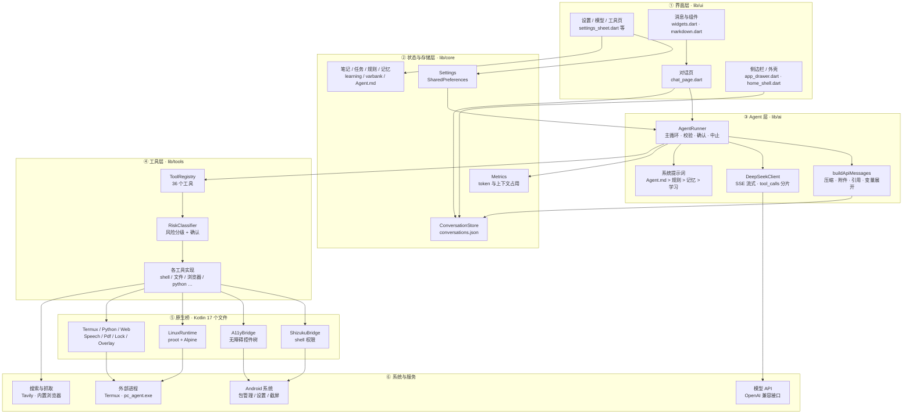
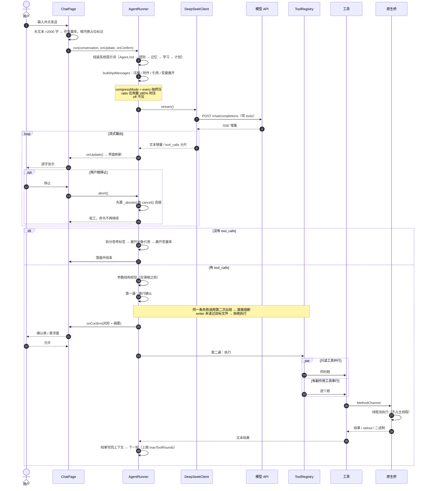
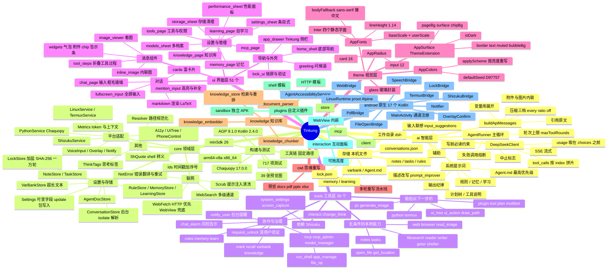

# Tinkung 架构图

三张图：运行时分层栈、一轮对话的时序、工程模块全景。
所有节点都能在仓库里找到对应文件，模块职责见 [工程手册](README.md)。

---

## 一、运行时分层栈

从用户点下发送，到命令真的在手机上执行，中间经过六层。
每一层只依赖下一层，跨层调用只有一处例外：界面直接读存储（列表、设置回显）。

阅读方式：**纵向是依赖**（上层调下层），**横向是同层协作**。
`③ → ④` 是唯一一条"由模型决定走哪条"的边 —— 工具名和参数都是模型给的，
所以参数校验和风险确认都发生在 `AgentRunner` 里，不在工具自己身上（工具无从拒绝）。

---

## 二、一轮对话的时序

包含工具调用、串并行、确认、中止五条分支。

几个容易画错的点，这里按代码写：

**确认在串行段之前。** 校验和确认是第一遍，全部过完才开始执行第二遍。
不然并行执行到一半跳出确认框，用户拒绝时前几个已经跑了。

**只读并行、有副作用串行。** 同一轮里重复的只读调用只跑一次。

**停止不是只断网络。** `abort()` 先置标志再断连接，两处都要查这个标志，
否则命令照样执行、下一页照样请求。

---

## 三、工程模块全景

---

## 四、数据流向速查

| 起点 | 终点 | 载体 |
|---|---|---|
| 用户输入 | 模型 | `buildApiMessages` 组装的 messages 数组 |
| 模型返回 | 界面 | `onUpdate()` 回调，逐帧刷新 |
| 工具调用 | 原生 | `MethodChannel`，见 `MainActivity.kt` |
| 原生结果 | 模型 | `run()` 返回的字符串 |
| 任何设置改动 | 磁盘 | `settings.update()` → `SharedPreferences` |
| 会话内容 | 磁盘 | `ConversationStore.save()` → JSON |
| 生成的文件 | 工作目录 | 外部存储或应用支持目录下的 `/dsh` |

---

## 五、图里没画的东西

诚实说明边界：

- **没有画时序图里的重试和降级细节**。网络失败由 `net_error.dart` 翻译后
  返回给模型，模型自己决定重不重试，这一层在 Agent 循环之上，不属于单轮时序。
- **没有画子智能体**。`multibot` 会新建一个 `AgentRunner` 跑独立任务，
  结构上和主循环是同一张图，画进来会变成递归。
- **没有画 MCP 的远端服务器**。它属于工具层的扩展，外部依赖，不在本仓库。
- **玻璃控件的 shader 路径没有画**。它属于 Flutter 引擎，预览图也证明不了它的观感。
