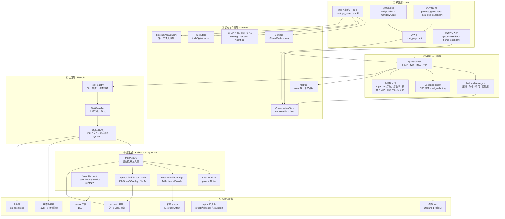
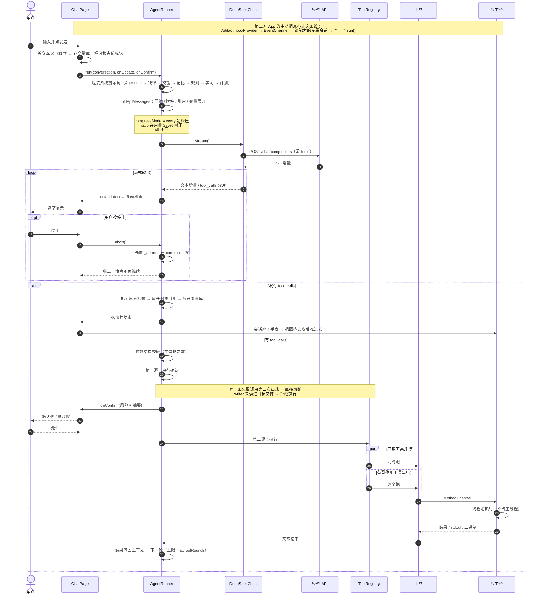

# Tinkung 架构图

三张图：运行时分层栈、一轮对话的时序、工程模块全景。
所有节点都能在仓库里找到对应文件，模块职责见 [工程手册](README.md)。

---

## 一、运行时分层栈

从用户点下发送，到命令真的在手机上执行，中间经过六层。
每一层只依赖下一层，跨层调用只有一处例外：界面直接读存储（列表、设置回显）。

阅读方式：**纵向是依赖**（上层调下层），**横向是同层协作**。
`③ → ④` 是唯一一条"由模型决定走哪条"的边 —— 工具名和参数都是模型给的，
所以参数校验和风险确认都发生在 `AgentRunner` 里，不在工具自己身上（工具无从拒绝）。

`ExternalArtifactStore` 里那份工具清单是从 `ExternalArtifactBridge` 读回来的，
那是**数据流向**、不是依赖方向，所以图里没有连这条线（连了会看成像存储层依赖原生层）。

工具表不是固定 36 条：插件、MCP 服务器、第三方 App 的 External Artifact 都会在
`_buildRegistry` 里**动态挂进来**，最后再按模型档案的白名单裁剪一次
（`retainWhere`）。没进注册表的工具模型根本看不见，也就不会浪费一轮去调用。

---

## 二、一轮对话的时序

包含工具调用、串并行、确认、中止五条分支。

几个容易画错的点，这里按代码写：

**确认在串行段之前。** 校验和确认是第一遍，全部过完才开始执行第二遍。
不然并行执行到一半跳出确认框，用户拒绝时前几个已经跑了。

**只读并行、有副作用串行。** 同一轮里重复的只读调用只跑一次。

**停止不是只断网络。** `abort()` 先置标志再断连接，两处都要查这个标志，
否则命令照样执行、下一页照样请求。

**过程条是流式的产物。** 每轮带工具的请求都会追加一条独立的 assistant 消息，
界面把连续几条过程轮收进一张 `ProcessGroup`（标题行说"现在在跑什么"，
跑完变成"共 N 次" + 思考回看），只有最后那条不带工具的回复算正文。

---

## 三、工程模块全景

```mermaid
mindmap
  root((Tinkung))
    ai 智能层
      AgentRunner 主循环
        轮次上限 maxToolRounds
        失败调用熔断
        写前必读约束
        中止标志
      系统提示词
        Agent.md 排在最前
        规则 / 记忆 / 学习
        计划树 / 工具说明 / 技能索引
        输出纪律
      buildApiMessages
        压缩三档 every ratio off
        附件与图片内联
        引用原文
        变量库展开
      DeepSeekClient
        SSE 流式
        tool_calls 按 index 拼片
        usage 取在 choices 之前
      辅助
        输入联想 input_suggestions
        描述改写 prompt_improver
    core 领域层
      设置与存储
        Settings 可变字段 update 包写入
        ConversationStore 后台 isolate 解析
        NoteStore / TaskStore
        RuleStore / MemoryStore / LearningStore
        VarBankStore 超长文本
        AgentDocStore
        LockStore 加盐 SHA-256 一万轮
        SkillStore 扫 tools 目录
        ExternalArtifactStore 发现结果
      平台适配
        LinuxService / PythonService
        TerminalSession 命令流水
        Garmin 设备与推送
        CustomFont 运行时导入
        VoiceInput / Overlay / Notify
      联网
        WebSearch 多级通道
        WebFetch HTTP 优先 WebView 兜底
        Scrub 提示注入清洗
        NetError 错误翻译与重试
      其他
        Metrics token 与上下文
        Ids 时间戳加序号
        ShQuote shell 转义
        ThinkTags 思考标签
        Resolver 路径规范化
    tools 工具层
      无条件的本地能力
        notes tasks
        web browser read_image
        open_file get_location
        filesearch reader writer geter sheller
        file_op dart:io
        varbank mark
      执行环境
        linux Alpine shell
        python Alpine python3
      能给出下一步的
        pc generate_image
        plugin tool plan multibot
        skill 技能文件夹
      按条件注册
        linux 平台支持
        garmin 绑定了设备
        mcp_admin 接了 MCP
        recall 开了跨聊天记忆
      协作与治理
        request_unlock 请用户验证
        notify_user 后台提醒
        chat_alarm 风险告示
        rules memory learn
        knowledge mcp model_manager
        interact change_think
      动态挂载
        plugin_* 自定义插件
        mcp_* 远端服务器工具
        artifact_* 第三方 App 工具
    ui 界面层 55 个
      对话
        chat_page 输入框毛玻璃
        fullscreen_input 全屏输入
        mention_input 高亮与补全
        markdown 渲染 LaTeX
        cards 富卡片
        deep_research_page 深度研究
      过程与计划
        process_group 工具过程卡片
        tool_line 图标与文字共用一行
        tool_steps 折叠工具过程
        plan_tree_panel 吸底计划表
      消息组件
        widgets 气泡 附件 chip 告示条
        inline_image 内联图
        image_viewer 看图
      设置与管理
        settings_sheet 条目式
        models_sheet 多档案
        font_settings_page 三档字体
        tool_call_table 工具调用表
        plugins_sheet 插件模板
        skills_page 技能文件夹
        external_artifact_page 第三方能力
        garmin_devices_page 手表
        knowledge_page 知识库
        memory_page 记忆
        learning_page 自学习
        mcp_page
        performance_sheet 性能面板
        storage_sheet 存储清理
      导航与外壳
        home_shell 底部导航
        app_drawer Tinkung 侧栏
        greeting 问候语
        lock_ui 锁屏与验证
    theme 视觉层
      AppFonts
        三档：界面 / 中文 / 代码
        uiFamily bodyFallback mono
        applyFonts 写静态字段
        运行时导入走 UserFont*
        baseScale × userScale
      AppColors
        defaultSeed D97757
        applyScheme 按亮度重写
      AppRadius
        input 12
        card 16
      AppSurface ThemeExtension
        pageBg surface chipBg
        border text muted bubbleBg
        isDark
      glass 玻璃封装
    cwt 思维重写
      多轮重写流水线
      预览 docx pdf pptx xlsx
    knowledge 知识库
      document_parser
      knowledge_chunker
      knowledge_embedder
      knowledge_store 检索与重排
    mcp
      client
      store
    plugins 自定义插件
      shell 模板（走 Alpine）
      HTTP 模板
    interaction 互动面板
      WebView 内嵌
      可拖高度
    android 原生 16 个 Kotlin
      MainActivity 通道注册
      LinuxRuntime proot Alpine
      ExternalArtifactBridge 发现与调用
      ArtifactInboxProvider 收消息
      GarminBridge / GarminRelayService
      AgentService 前台保活
      ActivityOverlay / OverlayConfirm
      SpeechBridge / WebBridge / PdfBridge
      LockBridge / FileOpenBridge / Notifier
    资源
      assets/alpine 迷你根文件系统
        alpine-minirootfs 3.24.1
        proot / loader
        apk.static
      assets/fonts Inter 四个字面
    存储 本机文件
      conversations.json
      notes / tasks / rules
      memory / learning
      varbank / Agent.md
      lock.json / plugins.json
      tools/名字/tool.md
      plans/convId.json
      工作目录 dsh
    构建与测试
      工具链 固定路径
      AGP 9.1.0 Kotlin 2.4.0
      minSdk 26
      arm64-v8a x86_64
      722 项测试
      40 张预览图
```

---

## 四、数据流向速查

| 起点 | 终点 | 载体 |
|---|---|---|
| 用户输入 | 模型 | `buildApiMessages` 组装的 messages 数组 |
| 模型返回 | 界面 | `onUpdate()` 回调，逐帧刷新 |
| 工具调用 | 原生 | `MethodChannel`，见 `MainActivity.kt` |
| 原生结果 | 模型 | `run()` 返回的字符串 |
| 任何设置改动 | 磁盘 | `settings.update()` → `SharedPreferences` |
| 会话内容 | 磁盘 | `ConversationStore.save()` → JSON |
| 计划树节点 | 磁盘 + 界面 | `plans/<convId>.json`，同一份喂提示词与吸底面板 |
| 第三方 App 的工具 | 模型 | 发现后包成 `ArtifactToolDef`，和内置工具进同一张表 |
| 第三方 App 的消息 | 专属会话 | `ArtifactInboxProvider` → EventChannel → 落成一条用户消息 |
| 最终回答 | 手表 | `GarminBridge.push()`，先去 Markdown 再按长度截断 |
| 生成的文件 | 工作目录 | 外部存储或应用支持目录下的 `/dsh` |

---

## 五、图里没画的东西

诚实说明边界：

- **没有画时序图里的重试和降级细节**。网络失败由 `net_error.dart` 翻译后
  返回给模型，模型自己决定重不重试，这一层在 Agent 循环之上，不属于单轮时序。
- **没有画子智能体**。`multibot` 会新建一个 `AgentRunner` 跑独立任务，
  结构上和主循环是同一张图，画进来会变成递归。
- **没有画 MCP 的远端服务器**。它属于工具层的扩展，外部依赖，不在本仓库。
- **没有画 External Artifact 的发现过程**。对方 App 用一个带
  `com.agt.tk.hwl.ARTIFACT_PROVIDER` 的 `ContentProvider` 自我声明，我们用
  `queryIntentContentProviders` 扫出来，再从它的 meta-data
  （`com.agt.tk.hwl.artifact_authority`）拿到 authority、按需读工具描述；
  这部分在 Kotlin 侧，协议细节见 [接入指南](external_artifact_guide.md)。
- **没有画技能（skill）的加载时机**。`SkillStore` 是单例，构建提示词和
  注册工具两条路径都会读它；首次启动时从 `assets` 播一份进来，之后归属文档目录下的
  `tools/`。正文按需用 `skill` 工具取，不常驻上下文。
- **玻璃控件的 shader 路径没有画**。它属于 Flutter 引擎，预览图也证明不了它的观感。

---

## 六、命名与兼容

身份证换过一次，但磁盘上的路径**故意没换**：

- 应用 ID 与包名是 `com.agt.tk.hwl`（早期版本叫 `com.dsh.dsh_agent`，
  Kotlin 源码已整体搬到 `android/app/src/main/kotlin/com/agt/tk/hwl/`）。
- 工作目录仍叫 `<外部私有目录>/dsh`，`MethodChannel` 前缀也仍是 `dsh/`。
  这些字符串都写进了用户已经生成的文件路径和已装 App 的协议里，
  改一次就等于让老用户的历史附件全部失效、第三方接入方全部对不上。
  名字是给新人看的，路径是给数据用的，两者不必同步。
